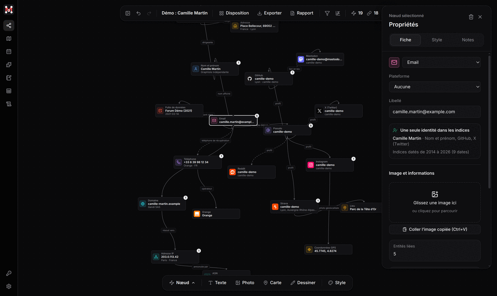
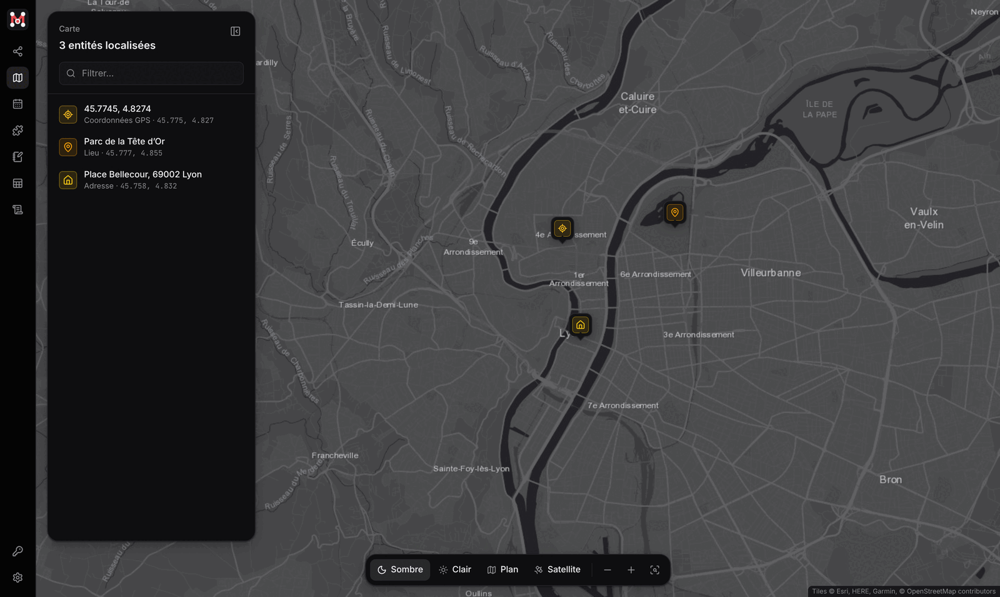
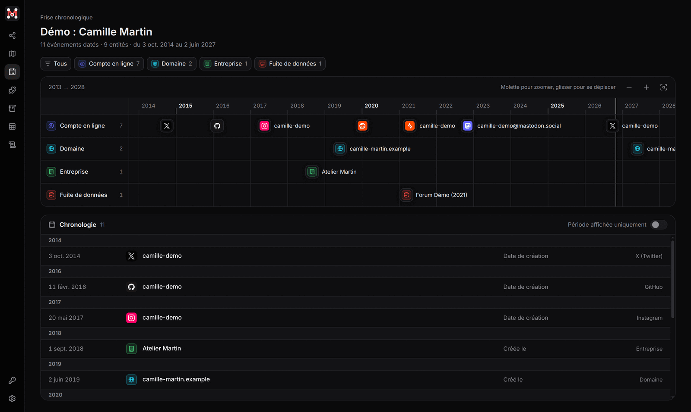

  

<h1 align="center">MASINT</h1>

  Application de bureau d'enquête en sources ouvertes (OSINT), organisée autour d'un graphe.
   
  Windows et Linux · français et anglais · licence Apache-2.0

  
  
  

<a href="#english">English version below</a>

Partez d'une donnée (email, téléphone, pseudo, domaine, IP, IBAN, portefeuille crypto...) :
plus de 200 modules interrogent les sources publiques, ou les services dont vous avez une
clé, et ajoutent ce qu'ils trouvent au graphe. Tout reste **sur votre machine** : pas de
compte, pas de serveur MASINT, pas de télémétrie.
L'application s'inspire de [Flowsint](https://github.com/reconurge/flowsint) pour le graphe
et de [roso.info](https://roso.info) pour les recherches.

## Fonctionnalités

- **Graphe** : entités, liens, notes, images et dessins sur le même canevas ; dispositions
  automatiques, plus court chemin, communautés, filtres.
- **Enrichissement** : plus de 200 modules (téléphone, email, pseudo, domaine, IP, crypto,
  entreprises, fuites de données, sanctions...), voir la [liste](docs/modules-list.md).
- **Provenance** : chaque élément garde le module qui l'a trouvé et sa date ; les hypothèses
  attendent votre validation dans « À vérifier ».
- **Preuves** : captures de pages horodatées et empreintées, journal d'activité vérifiable.
- **Carte, frise chronologique, tableau et notes** pour lire l'enquête autrement.
- **Proxy et Tor** pour toutes les requêtes, DNS compris, avec un mode passif qui écarte les
  modules qui contactent la cible.
- **Exports** : PNG, SVG, CSV, JSON, page HTML interactive, Gephi, Maltego, rapport PDF et
  archive `.masint` à partager.

<table>
  <tr>
    <td></td>
    <td></td>
  </tr>
  <tr>
    <td align="center">Carte</td>
    <td align="center">Frise chronologique</td>
  </tr>
</table>

Le détail de chaque fonctionnalité est dans le [guide d'utilisation](docs/guide.md).

## Installation

Téléchargez la dernière [release](https://github.com/mateo-brl/masint/releases/latest).

- **Windows 10 et 11** : lancez `MASINT-Setup-<version>.exe`. L'exécutable n'est pas signé :
  dans SmartScreen, cliquez sur **Informations complémentaires** puis **Exécuter quand même**.
- **Linux** : `sudo apt install ./masint_<version>_amd64.deb` (Debian, Ubuntu, Mint...), ou
  l'AppImage pour les autres distributions.

Les mises à jour se téléchargent ensuite d'elles-mêmes. Tor, clés API, emplacement des
données : voir le [guide](docs/guide.md).

## Prise en main

1. Sur l'accueil, saisissez une donnée puis **Lancer l'enquête** : MASINT reconnaît son type.
2. Sélectionnez un nœud et cliquez sur **Enrichir** : les résultats arrivent dans le graphe.
3. Recommencez sur les nouveaux nœuds, reliez, annotez, puis exportez ou générez le rapport.

## Documentation

- [Guide d'utilisation](docs/guide.md) : fonctionnalités, installation, clés API, réseau et Tor
- [Liste des modules](docs/modules-list.md) et [écrire un module](docs/modules.md)
- [Développement](docs/developpement.md) : commandes, publication d'une version, architecture
- [Contribuer](CONTRIBUTING.md)

## Usage responsable

MASINT est un outil de recherche en sources ouvertes. Son usage engage **votre seule
responsabilité** :

- utilisez-le dans un **cadre légal** (journalisme, recherche, sécurité informatique,
  vérification diligente, procédure judiciaire, recherche de vos propres traces...) ;
- les données collectées sont souvent **personnelles** : en Europe, le **RGPD** impose une
  base légale, une finalité précise, la minimisation des données et une durée de
  conservation limitée ;
- respectez les **conditions d'utilisation** et les quotas des services interrogés ; le
  connecteur roso.info utilise votre propre compte et vos crédits, à votre demande ;
- les résultats ne sont pas garantis : recoupez toujours vos sources.

Ce projet n'est affilié à aucun des services interrogés ; leurs marques et logos servent
uniquement à les identifier.
Texte complet : [mentions légales et éthique](docs/guide.md#mentions-légales-et-éthique).

## Licence

[Apache 2.0](LICENSE). © 2026 Mateo Baril. Composants et données tiers : voir [NOTICE](NOTICE).

---

## English

**MASINT** is a desktop app (Windows, Linux) for open-source intelligence investigations,
built around a graph. Start from an email, phone number, username, domain, IP, IBAN or crypto
wallet: 200+ enrichment modules query public sources (or services you hold an API key for)
and add what they find as new nodes and links. Map, timeline, Tor and proxy routing, evidence
capture, PDF report and many export formats. Everything stays on your computer.

**Install**: download the latest [release](https://github.com/mateo-brl/masint/releases/latest).
On Windows, run `MASINT-Setup-<version>.exe` (not code-signed: click *More info* then *Run
anyway* in SmartScreen). On Linux, use the `.deb` package or the AppImage. The interface is
available in English (Settings > General).

**Legal**: use MASINT lawfully, comply with data protection law (GDPR in Europe) and with the
terms of the services you query. Documentation is in French; see
[docs/developpement.md](docs/developpement.md) to build from source. Licensed under
[Apache 2.0](LICENSE).
